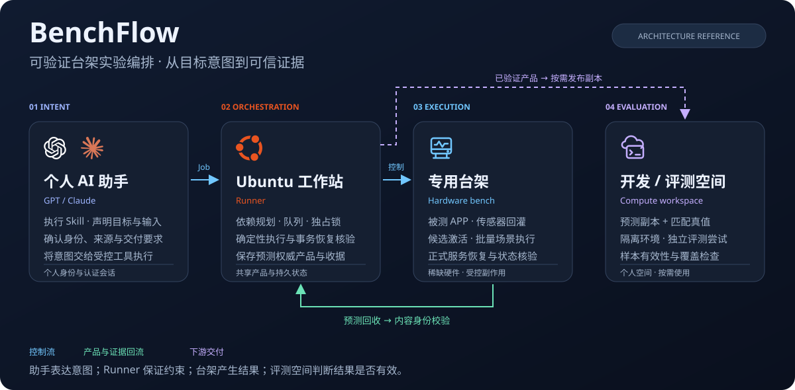
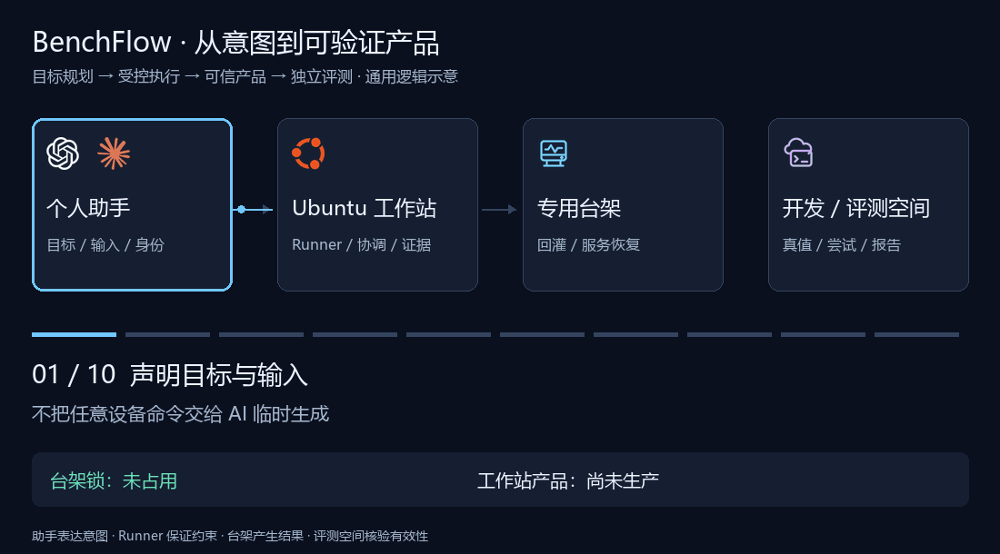
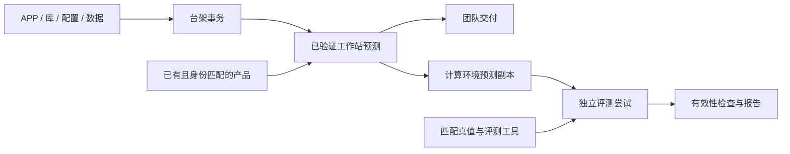
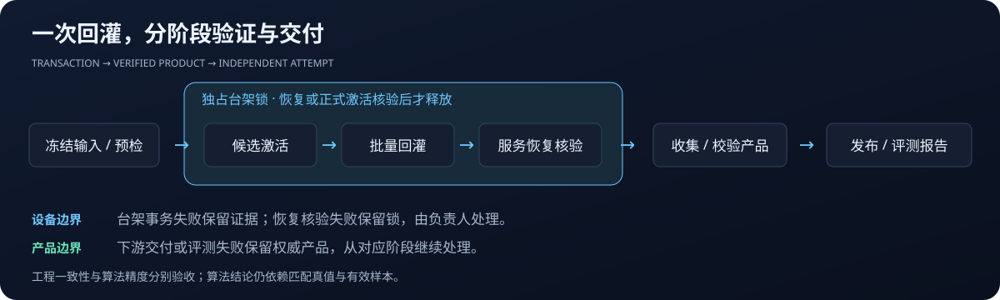

# BenchFlow · 可验证台架实验编排

**连接个人 AI 助手、确定性执行器、共享台架与评测环境的实验编排参考实现。**

Bench 表示共享实验台架，Flow 表示围绕目标、资源与证据组织的流程。名称突出项目的架构价值；预瞄悬架是这一设计落地的具体场景。

**[播放架构演示](https://inner-vic.github.io/preview-suspension-bench-eval/)** · **[阅读设计契约](docs/architecture.md)** · **[了解工作站 Runner](docs/workstation-runner.md)** · **[查看公开边界](docs/publication.md)**

本项目来自预瞄悬架感知链路的离线台架评测实践。其可迁移价值在于：如何把跨设备、跨平台、存在副作用的实验，组织为**输入明确、资源受控、结果可验证、失败可恢复**的工作流。

真实回灌依赖专用台架、传感器接口、商业软件和内部计算环境。公开仓库提供经过脱敏的编排源码、离线测试、接口示例与设计说明，适合研究实验基础设施和 AI 工具架构。接入新的设备环境需要重新实现或验证适配层。



**[交互架构演示](https://inner-vic.github.io/preview-suspension-bench-eval/)**：可以播放、暂停和逐步查看四种情境，包括完整执行、已有产品复用、上传失败续接与恢复失败保留锁。也可下载 [演示文件](docs/index.html) 后直接在浏览器中打开。



> 核心主张：用目标表达意图，用契约约束执行，用证据决定复用与交付。

图中的 GPT / Claude、Ubuntu 与开发空间用于识别环境角色。助手选择不改变执行器契约，计算空间可通过适配层替换；图标素材与使用说明见 [视觉素材说明](docs/visual-assets.md)。

## 背景：算法迭代需要可信的实验基础设施

预瞄悬架利用前方道路信息支持后续控制决策。本项目聚焦其中的感知结果生产与离线评测：将已录制的传感器数据送入运行真实软件的台架，回收预测，再与对应真值进行比较。它不实现悬架控制算法，也不替代车辆道路试验。

一次实验往往跨越四种环境：

| 环境 | 主要职责 | 特有约束 |
| --- | --- | --- |
| 个人电脑 | 确认目标与输入，提交任务，查看结果 | 个人身份、认证会话与操作意图 |
| 共享工作站 | 准备资源、编排执行、保存证据和预测产品 | 多人协作、持久化、网络与容量 |
| 专用台架 | 运行被测 APP，接收传感器回灌并产生预测 | 稀缺硬件、动态库匹配、服务切换与恢复 |
| 评测计算环境 | 读取预测和真值，运行评测器，生成报告 | 数据布局、依赖环境、个人空间与任务覆盖 |

包版本、传感器库、配置、回放端点、场景顺序和真值布局共同决定实验含义。任何一项变化都可能改变结果；单凭“脚本跑完”或“目录里有文件”，无法判断实验是否成立。

因此，评测的可信度既取决于算法与真值，也取决于产生结果的过程是否受控、输入是否一致、证据是否完整。

## 必要性：把人工经验变成显式约束

手工流程需要操作者记住登录路径、服务状态、文件位置和恢复顺序。随着参与者与实验数量增加，隐含知识会成为协作瓶颈：

- **实验可比性难以保证。** 相同的软件名称可能对应不同动态库、配置或数据内容。
- **共享硬件容易相互干扰。** 两个人分别执行正确的命令，也可能组合出错误的设备状态。
- **故障影响范围容易扩大。** 上传失败若导致整条流程重跑，会重复消耗台架时间并引入新的变动。
- **成功判断容易过早。** 退出码为零可能伴随空预测、真值未匹配或某些任务没有有效样本。
- **交接依赖个人记忆。** 缺少输入身份、执行记录与恢复证据，其他人难以解释或接续一次实验。

项目将这些条件落到任务协议、配置边界、资源锁、事务执行、产品收据与评测有效性检查中。自动化既减少重复操作，也让实验的成立条件可以被机器检查、被其他人复核。

## 核心思想：按目标规划，按证据推进

### 用所需产物表达意图

用户可能只需要工作站预测，也可能需要上传已有预测，或对已有预测重新评测。将所有需求固定为一条从刷包到报告的流水线，会浪费硬件资源，并增加不必要的副作用。

任务因此声明来源与目标，由规划器解析依赖。目标包括工作站预测、计算空间预测副本和评测报告。已有产品只有在收据、当前文件清单和内容身份同时匹配时才可复用。



这一设计将昂贵的结果生产与下游处理分开。评测器或报告需求变化时，已有合格预测可以成为新的实验输入。

### AI 理解意图，确定性程序约束执行

个人 AI 助手负责理解需求、补齐当前步骤必要的输入，并通过执行 Skill 调用工具。共享工作站运行确定性的 Runner，负责校验任务、管理队列与锁、执行事务和记录证据。

Job 不携带任意 `shell`、`command` 或 `argv`，而是选择 Profile 中已定义的命令集。设备控制细节由适配层实现。关键不变量由程序检查，不依赖模型每次生成正确命令，也不依赖对话中的临时记忆。

| 层次 | 职责 | 边界 |
| --- | --- | --- |
| 意图与交互层 | 解释需求，确定输入和目标 | 不替代执行器的状态与身份检查 |
| 任务协议层 | Job、Profile、来源、目标与授权记录 | 任务数据与受控执行命令分离 |
| 规划与协调层 | 依赖解析、复用判断、队列与锁 | 按真实依赖判断是否需要硬件 |
| 执行与适配层 | 安装、激活、回灌、恢复、传输、评测 | 环境相关实现集中在明确接口后 |
| 产品与证据层 | 清单、内容身份、收据、日志与报告 | 成功必须有可以核验的结果 |

### 将硬件变更视为需要补偿的事务

台架包含进程、网络端点和正式软件目录，无法像数据库一样原子回滚所有动作。因此项目采用显式基线捕获、阶段记录和补偿恢复。

候选回灌的关键顺序是：

`预检 → 捕获基线 → 停止正式服务 → 激活候选 → 检查候选 → 回灌 → 恢复服务 → 核验恢复`

只有在恢复或正式激活结果核验后才释放台架锁。恢复失败时保留锁与证据，交由负责人处理；无法证明设备安全时，后续任务不会自动接管。

**服务恢复与软件回滚表达不同状态。** 正式更新验收后可以保留新软件，后续回灌仍需恢复它的正式服务。区分这两个概念，可以避免“服务正常”被误当成“安装内容已回滚”。



### 将输出提升为具有身份的产品

目录名称和历史成功状态容易过期。工作站预测产品使用逐文件清单、清单哈希与产品身份，将结果关联到对应输入和生产 run。

成功收据只是复用候选，复用前还需检查当前内容。目标冲突或残留 partial 时保留现场，避免静默覆盖。工作站成为共享预测的权威来源，个人计算环境保存副本和独立评测尝试。

这一分工让团队能够复用结果，同时隔离个人认证、评测配置与尝试记录。

### 按故障边界恢复，保留失败的证据

Run ID 固定一次执行的身份。失败评测保留在独立尝试目录，重试生成新尝试；成功的台架事务不会因为后续上传失败而再次回灌。

尚未激活时停止并保留证据；已激活时先恢复设备；已有已验证预测时，从交付或评测阶段继续。批次入口也提供仅补交付的恢复路径，但不能将回灌或恢复失败伪装成成功。

这些机制只支持已定义、能够核验的恢复边界，不代表任意步骤、任意帧都能自动续跑。

### 区分过程、交付与算法效果

| 判断层次 | 证据 | 结论范围 |
| --- | --- | --- |
| 过程完成 | 目标状态、事务记录、服务恢复核验 | 执行过程满足约定 |
| 交付完整 | 必需预测类型、文件清单、内容身份 | 产品结构和传输一致 |
| 评测有效 | 对应场景、匹配真值、有效样本、任务覆盖 | 指标具有可解释的输入基础 |
| 算法达标 | 有效指标、比较基线、明确验收要求 | 是否达到本次算法目标 |

低层成功不能替代高层结论。没有匹配真值时，应报告覆盖缺口；没有验收阈值时，应报告指标而非自行宣称达标。

## 架构取舍：为何这样划分

**共享工作站作为执行与证据中心。** 个人电脑的会话和环境不稳定，台架不适合承担复杂编排。将持久任务、共享缓存和结果集中在工作站，便于协作与交接。代价是工作站成为重要依赖，需要关注存储、访问控制和服务可用性；当前实现不宣称具备高可用调度能力。

**台架锁只覆盖必要资源。** 回灌和激活需要独占设备；仅上传或评测已有结果的任务不应争用台架。执行器依据不可变 Job 与 Profile 重新计算硬件依赖，避免把所有任务都强制串行化。

**同组输入按批次执行。** 多场景共享一次占用、恢复和集中收集，减少重复切换，通过场景标记分开输出。代价是批次必须满足适配器兼容性、容量和超时约束；大批量需要预估耗时并分批。

**配置不等于适配能力。** 改一个端口字段不会让动态库、健康检查和回放驱动自动兼容。协议可以统一，不同硬件与软件组合仍需要新基线和实机验证。

**校验集中在关键边界。** 输入准备、产品形成和最终交付进行身份核验，避免在受控批次内部反复做相同检查。校验强度与执行成本需要结合阶段风险安排。

更多实现映射与失败处理见 [架构说明](docs/architecture.md)。

工作站执行层的源码范围、独立 release、稳定入口、任务持久化与会话边界见 [工作站 Runner 设计](docs/workstation-runner.md)。

## 工程价值与可迁移范围

项目把实验经验沉淀为显式契约，使团队能够解释结果使用了什么输入、由谁提交、在哪个阶段失败、设备是否恢复，以及后续应从哪里继续。

可迁移的原则包括目标驱动的依赖规划、AI 与确定性执行分层、稀缺资源协调、外部副作用的补偿恢复、具有内容身份的产品，以及分层的成功判断。这些原则也适用于硬件在环测试、机器人实验、嵌入式回归和其他共享设备工作流。

不能直接迁移的部分包括 APP、传感器动态库、设备服务、回放协议、构建工具链、真值格式与平台认证。替换环境时应保留核心契约，重新实现适配层，先验证小场景，再推广批次流程。

仓库没有提供通用硬件支持或算法提升数据，也未量化效率收益。其价值应结合代码、离线测试与实际接入验证来评估。

## 源码阅读路径

```text
automation/
├── workflow_planner.py       # 来源、目标、依赖与复用
├── runner_state.py           # 持久状态、队列、归属与台架锁
├── bench_transaction.py      # 候选激活与补偿恢复
├── direct_package_install.py # 安装边界与验收
├── target_workflow.py        # 串联产品与执行节点
├── workflow_receipts.py      # 节点收据与内容身份
├── prediction_transfer.py    # 权威产品与下游副本
├── evaluation_runner.py      # 独立评测尝试与有效性
├── bench_eval.py             # 统一 CLI
└── test_*.py                 # 离线约束与故障路径测试
skills/bench-eval-execution/  # 个人助手的执行边界与工具入口
docs/                        # 架构说明、工程图示与脱敏说明
```

建议先读规划器与状态管理，再读事务和收据，最后查看环境适配器。源码保留部分历史接口名称，例如 `lpai`，用于展示已有适配位置，不表示公开仓库可访问对应内部平台。

## 本地探索：不连接台架

使用 Python 3.12，在仓库根目录执行：

```powershell
python automation/bench_eval.py capabilities
python automation/bench_eval.py plan --job automation/jobs/coordination-smoke.example.json
python automation/bench_eval.py audit
python -m unittest discover -s automation -p "test_*.py"
python -m unittest discover -s skills/bench-eval-execution/scripts -p "test_*.py"
python -m unittest discover -s skills -p "test_build_skill_packages.py"
```

前三条命令展示协议、规划与实现覆盖，不触发真实回灌。示例地址使用文档专用网段，账号、路径和内容身份为脱敏示例。离线测试检查部分逻辑约束，无法证明传感器协议、真实服务恢复或预测精度。

接入设备前，需要准备本环境的 Profile、受控命令集与适配器，核对软件和传感器依赖，确认恢复路径并完成实机准入。内部构建补丁、原始回放源码快照、真实数据、商业二进制和原运行证据不包含在公开副本中。脱敏范围见 [公开副本说明](docs/publication.md)。

本仓库暂未声明开源许可证。公开可读与授权再分发是不同事项，使用源码应遵守适用的授权要求。
