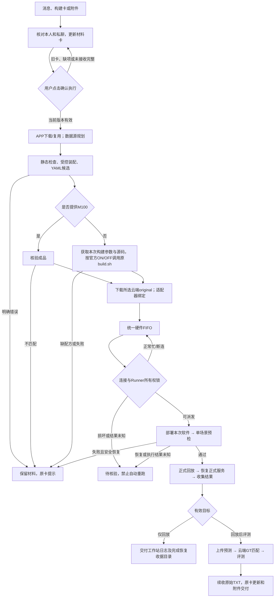

# 实际执行流程

## 输入与目标

| 输入 | 提供方式 | 规则 |
|---|---|---|
| LIVC APP | HTTPS 链接、受支持的完整 CCU 文件名、可读取转发构建卡 | 文件名按管理员下载根补全；使用本人确切资产 |
| 构建链接 | Jenkins 链接或构建卡 | 与APP构建号核对；按集成锁、Conan修订和准确源码自动准备编译输入，真实接口缺失则停止 |
| `libxcamera.so` / `libxlidar.so` | 聊天附件、授权工作站路径或链接 | 首次提供；同一人可沿用候选，继续检查架构和限定符号 |
| `liburoad_m100.so` | 可选成品，缺省 `build_if_missing` | 新 APP 清除旧 M100；缺省按本 APP 配方编译；失败说明缺项 |
| 数据集 | 工作站绝对路径或已授权云端卷路径 | 必须显式指定；场景级检查；云端布局须可定位 original 和任务GT |
| YAML / 附加要求 | 附件，或明确文件、字段、新值的聊天 | YAML非必选；生成本任务副本和差异，不改原 APP |
| 回放方式 / 目标 | 材料卡选择 | 流式/逐帧；新任务默认回放后评测，明确仅回放跳过评测 |

成功材料可作为下一份草稿基础，不能当作台架当前软件。正式任务部署本次冻结版本，避免其他同事刷包后误用。

## 主链路

## 材料、记忆与确认

原附件必须核对消息 ID、发送人、会话和文件名；字节直接下载工作站，完成传输和哈希后关联材料。收到消息不等于文件已可用。

未提交时合并当前草稿。换 APP 清除旧 M100、临时 YAML 和成功装配标志，传感器 SO只保留候选。只改本轮配置时沿用本人确切基础材料；普通新任务不继承上次临时 YAML 或“仅回放”目标。

确认绑定本人、私聊、原卡、nonce、任务和版本。入队前材料变化使确认失效；入队后冻结，补件用于下一份任务。附件、表单保存、口头执行、材料齐全不替代真实点击。

## 材料准备

工作站直接 HTTPS 下载 APP。版本化来源可复用本人缓存，仍核对实际文件；不跨人取同名包。数据只检查场景入口、清单和授权路径，不常规逐帧遍历。

静态检查包括压缩包安全、架构、替换目标和限定 provider 符号，不能替代完整 ABI 或本次运行。命中已核验配方才装配副本。旧收据只按本人已登记迁移映射解析，继续核对文件和配方摘要。

YAML明确冲突在编译前反馈。缺 M100 时，APP/传感器和配置前置检查通过后编译；前面失败使编译尚未开始，不应描述为编译失败。新包自动定位精确源码和锁，通用工具链不继承旧APP源码。接口/锁不匹配时要求配套成品，不盲目换库。

云端先列场景，软件检查通过后只下载所选 original；完成场景复用，缺失场景补下载，内容变化需重新登记。GT保留云端。绑定 READY_FOR_GATE 表示配置可派发，不是实机通过。

程序升级使适配器源码摘要变化时，未提交的旧准备重新检查并绑定；本人材料和有效确认不重置。已提交Job保持冻结，不自动替换其执行代码身份。

## 统一调度、预检和恢复

材料任务、Preparation、硬件 Job、预检 Run 和正式 Run 分开管理。PCM板端进入 jobs 硬件队列，CPU/云端进入后处理或独立业务线程；Runner原子JSON锁是最终互斥边界。本轮已将旧版共享板端入口接入同一队列，尚未接入的新版入口保持关闭。业务记录与报告独立。作用和异常矩阵见[调度锁与异常处理](07-调度锁与异常处理.md)。

正常忙在同一 Job 等待，不新建 Run。预检完成后正式阶段遇忙，保留预检收据，重新领取时不重复已完成预检。板端未知结果待核验，不按 PID 消失、超时或连接恢复重跑。

当前即使仅选一个场景，也先预检再正式执行该场景一次，合计两次。这是现有策略；精简需单独验证，不能因改名而跳过收据门禁。

计数100%后仍需恢复服务、核对输出和完成收据。进程中断只在证据完整时续交付，证据不足保留待核验。

## 评测与交付

仅回放只跳过指标评测，不切换官方软件的编译宏或运行配置：ON且已开启落盘时仍回收预测结果；OFF且落盘关闭时交付日志、完成及恢复收据目录。回放后评测要求官方ON版和配套落盘配置，缺项提前提示，不将OFF改成ON。回放完成与评测Job交接仍在同一事务中完成；评测失败不重放台架。详见[M100构建规则](11-M100官方构建与自动编译.md)。

工作站只打包所需预测，上传独立输出卷，以稳定任务身份和签名请求交给固定实例。新任务GT来自冻结数据源的显式关联，按完整场景标识匹配，不默认 V151，也不把预测写回输入目录。

云端心跳表示接收端就绪，不是账号续期。实例停止、授权过期、GT缺失、结果未知应区分；未知结果只续收原任务，不盲目再运行评测器。

报告保留工作站，机器人引用原任务交付 TXT。缺指标保留部分完成，不改阈值或删项。通知重试只重试通知。

新策略已禁止完成后追加评测；仅回放准备不能升级为评测。旧任务冻结记录及安全恢复代码保留，到点精度仍为独立可选能力。新日志交付的实机及中断恢复尚未验收，证据不足继续待核验，不自动重放。
