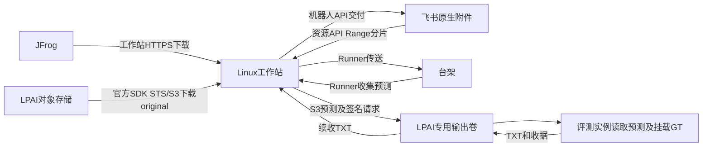

# 设备、数据传输与文件管理

| 设备 | 职责 | 权威存储 |
|---|---|---|
| Windows常驻电脑 | CC Connect唯一飞书连接、SSH入口；受限Codex解析 | 程序、静态配置、本机SSH/Codex认证及少量连接索引 |
| Linux `ubuntu-workstation` | 业务、准备、统一调度、Runner、上传与交付 | SQLite、附件、APP/SO、数据集、编译、结果、报告 |
| 台架 | 软件部署、预检、真实回放 | 受控运行目录；结果由Runner收集回工作站 |
| LPAI专用实例（接入`benchflow-pcm-test1`中） | 挂载数据/GT、验签、固定评测器；待平台审批和接收端重绑 | 独立持久输出卷内预测、收据和TXT；旧任务策略保留 |

## 大文件经过哪里



Windows传递消息元数据、控制和结构化解析，不中转业务大文件。工作站本地模式的 SSH 封装实际走本机程序，不应由名称推断绕回Windows。

JFrog凭据在工作站私有目录，以HTTP认证直接下载，无需在工作站打开浏览器。LPAI SDK以工作站主认证取得短期STS；短期凭据可重新获取，主认证失效仍需受控重新登录，不能承诺永久免登录。

## Linux职责树

```text
/mnt/data/bench-eval/
├── service/gateway/                 生产代码、解析Skill和运行配置
│   ├── bench_gateway/               准备、调度、回放、评测、通知
│   ├── config/                      配方与生产配置，不能用模板覆盖
│   ├── runtime/                     私有凭据、租约、监督器状态、日志
│   └── .cc-connect/attachments/      飞书原消息接收副本
├── service/roadmodel/<release>/     另一项目固定发布
├── state/
│   ├── gateway.sqlite3              材料、确认、任务和队列权威状态
│   ├── ai-requests.sqlite3           受限解析请求
│   ├── roadmodel/                   另一项目业务状态
│   └── users/u_<摘要>/inbox,reports/ 本人附件和交付过程
├── users/u_<摘要>/
│   ├── catalog.json                 本人资产登记
│   ├── package/<sha>/asset.bin       APP原件
│   ├── dependency/<sha>/asset.bin    SO原件
│   ├── prepared-packages/           受控装配副本和收据
│   ├── builds/                      M100源码副本、编译和产物
│   ├── build-inputs/<app-sha>/       精确源码、集成锁、构建锁及私有Conan缓存
│   ├── preparations/                YAML、差异、冻结清单
│   ├── assemblies/                  成功装配归档
│   └── tasks/                       本人输入和交付副本，以收据为准
├── datasets/<源目录名>/             source.json、original和.prepared
├── tasks/<run-id>/                  Runner结果、预测
├── runs/<run-id>/                   状态、恢复及产品收据
├── candidates/, environments/       固定适配器和运行依赖
└── backups/<变更批次>/               原文件、数据库快照和原始证据
```

APP/SO本人隔离；数据集统一缓存，不分Shared/Private。同名但不同卷或来源不合并。YAML保留本轮原件、差异和生效副本，不建通用配置资产库。

树是职责说明，结果路径从冻结收据读取，不能凭编号拼目录。旧 `/home/lixiang/bench-eval`、`bench-gateway` 仍有Runner扩展及兼容依赖，不批量搬迁。

Runner CLI `/home/lixiang/bench-eval/bin/bench-eval` 经candidate-environments扩展调用。台架锁是 `/home/lixiang/bench-eval/locks/bench.lock`，与网关进程锁、数据库事务锁不同。

## 云端挂载和输出

| 挂载 | 用途 |
|---|---|
| `/mnt/volumes/jfs-dip-vfsc-dataset-ga` | 授权回放输入卷；自动下载须显式白名单 |
| `/mnt/volumes/jfs-dip-vfsc-chassis-ga` | 可供任务关联GT的卷 |
| `/mnt/volumes/vc-chassis-bd-ga` | 独立预测、收据、报告输出卷 |

`/lpai/volumes/...`规范化为挂载路径；不默认PCM/V151根。新评测带本任务 evaluation_source，手工工作站源若要评测，也要有云端GT关联。

输出根 `/mnt/volumes/vc-chassis-bd-ga/bench-eval-offline/developer/runs` 按本人摘要与稳定评测任务区分。账号前缀是当前部署边界，不随消息发送者切换账号。cloud_storage.py仍固定卷UID和输出前缀；更换空间须同时审查代码、profile和接收端。

实例程序 `/lpai/bench-eval-offline/runtime`；Jupyter配置 `/lpai/bench-eval-offline/jupyter-config`。业务逻辑只读GT不等于平台只读，最近已核验卷权限均为Writable。

## 生命周期

业务数据不进Git；现场备份和审计原件留Linux。活动、待核验、未交付、有引用材料不按时间自动删除。此次不清任务、移动生产数据或改写历史结果。未来保留策略须先核对引用、状态、磁盘和恢复方法；统一目录并不自动解决生命周期管理。
