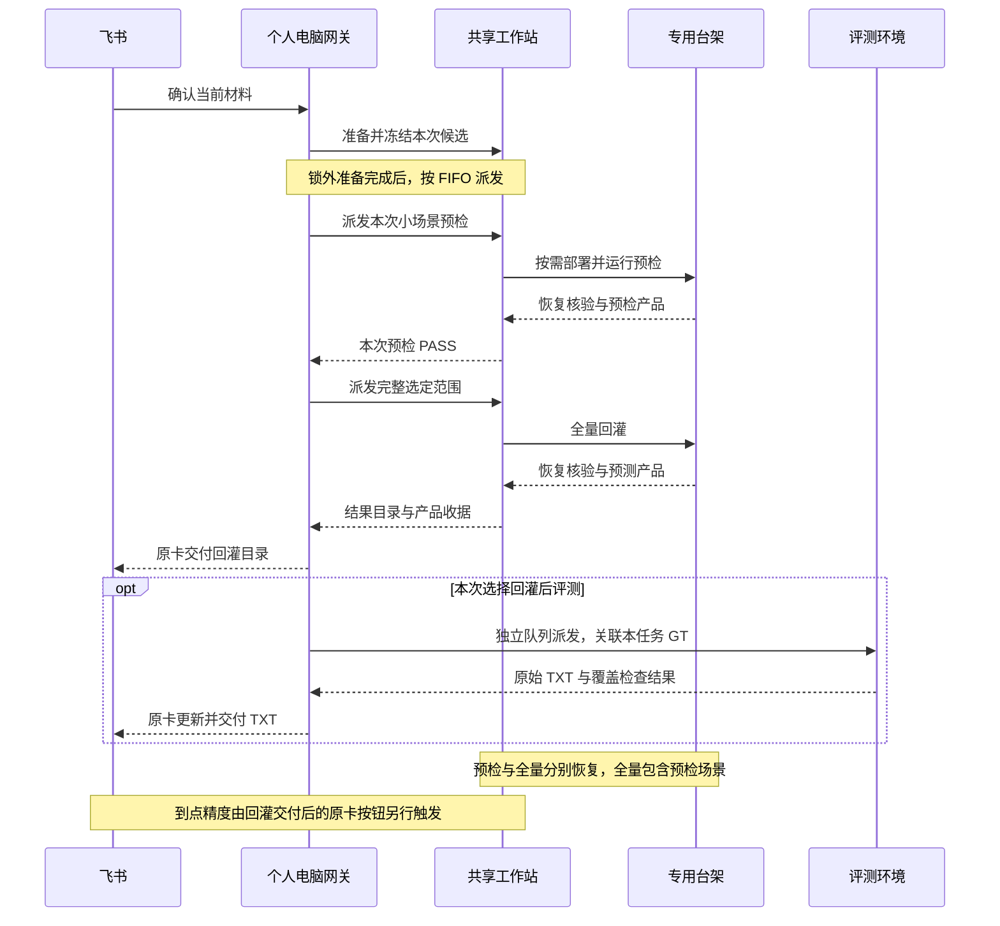

# 当前系统：飞书统一入口与实际执行链路

核对日期：2026-10-29。本文依据统一入口的当前源码及当天变更约定编写，区分当前业务入口、复用的底层工具和历史验证。完整统一入口在独立网关维护，内部仓库存有源码快照和文件身份。本公开副本提供当前链路与职责说明，不直接分发整套组织内网关、平台适配或生产依赖。

## 用户从哪里开始

当前业务入口是飞书机器人私聊中的同一张材料/任务卡。用户发送 APP 链接、可读取的转发构建卡、SO/YAML 附件，或选择本人已经核验的装配存档；卡片补充数据路径、场景范围、回放方式和任务目标。Codex 只把意图转换成受限字段，固定程序处理身份、材料、确认、排队和执行。

卡片默认选择“回灌后评测”和流式回放，允许本次选择“仅回灌”或逐帧。数据路径应明确本次来源，新云端路径和 GT 关联不以 PCM/V151 兜底；代码仍保留旧共享源别名兼容，不能把它解释为任意新任务的默认 GT。

“确认执行”绑定本人、私聊、当前材料版本和原卡。未收完附件、仍在编辑、材料版本变化或重复点击不能提交旧材料。确认后自动检查与排队，入队前材料变化使原确认失效；已提交材料冻结，后续软件/YAML 变更用于下一份任务。执行目标有单独控制记录，可在评测尚未领取时按允许状态调整；不改写冻结软件输入。

## 一条业务任务怎样执行

<!-- BEGIN EXECUTION SEQUENCE -->

<!-- END EXECUTION SEQUENCE -->

### 1. 准备发生在台架占用之前

材料正式副本保存在工作站本人目录，原生附件只用于 SO/YAML；APP 和大型数据不经飞书附件中转。M100 成品可直接使用，受支持版本可按已登记配方在工作站编译；没有匹配配方就补相应材料，不把任意构建页当作编译来源。

YAML 按本次明确修改生成候选、diff 和收据，不建立跨任务配置资产库。软件新包不能自动继承旧 M100 或临时 YAML。已验证装配可免去重复下载/装配，但仍需本次数据、确认和小场景预检。

工作站数据源的首次登记与复用均采用场景级检查：核对小 manifest 身份、场景、关键目录和路径归属，不逐帧枚举图片或重新统计帧数。管理员专项诊断才显式启用逐帧检查。轻量检查不证明每帧内容完整。

云端数据路径通过官方 SDK 的短期只读凭据，由工作站直接下载本次选中场景所需的 `original` 输入；凭据经 SSH 标准输入传递，GT 不下载，数据不经过个人电脑或 CC Connect。计划固定对象、大小和 ETag，已有完成快照可复用；改变范围从原云端根重新规划。

### 2. 每个新任务都先预检，再全量

候选固定本次包、三项 SO、配置、数据范围、适配模板、实现身份与回放方式。`READY_FOR_GATE` 只表示可以做本次验证，不是运行兼容或算法通过。

`Executor.replay_pipeline` 先执行 `<run>-smoke`，取本次选中范围的第一个场景；PASS 且绑定身份一致才调用完整 `<run>`。全量仍包含预检场景，因此该场景会再次回放。当前是两个 Runner 事务，分别恢复与留存，不是预检后无缝延长同一把锁。恢复续接在同一原任务下可以复用已经独立核实的预检收据，不能用任意历史成功代替本次预检。

派发前合并检查 Runner、容量、队列和 Job/Profile，再决定是否需要安装。台架正式文件已与候选清单一致时可复用；否则通过既有安装器应用本次软件并验真。安装器与回灌继续遵守原 Runner 锁协议；不能把入口 FIFO 说成一个覆盖安装、预检与全量的连续硬件事务。

回放继续经过 `precheck → capture_baseline → stop_active → start_candidate → health_candidate → replay → restore → verify_restore`。相机/雷达启动检查共享 180 秒上限，只看本次新增日志；明确崩溃或重复启动会提前失败。收尾按精确服务名核对注销和恢复，不能把崩溃后的临时 inactive 当作恢复成功。

适配器还派生本次固定配置覆盖，包括开启回放/台架模式、关闭若干业务门禁、启用预测输出、关闭 GT 轨迹输出，以及设置本次输出和场景 marker 路径。用户 YAML 是输入，不能在文档中称为不经处理直接原样执行。新逐帧/云端原始帧分支派生本人任务客户端，只改受审阅的 Recorder 模式及输入读取，不覆盖共享客户端、Recorder 或 Runner。

### 3. 入口 FIFO 与工作站锁各管一层

个人电脑持久 FIFO 和单调度器负责用户任务顺序；工作站 JSON `bench.lock` 继续保护遵守原协议的安装、回灌和清理操作，也协调其他工作站入口。不是两个独立用户调度器。

尚未派发且资源忙/连接不可达时保持等待。硬件任务已派发后结果未知进入 `NEEDS_REVIEW`，阻止新的硬件变更；电脑或 SSH 恢复不能触发自动重放。只有正面证据证明首次未派发、无历史尝试且 Runner 空闲时，拒绝才只使本任务失败，不扩大为全局待核验。锁不得按超时、PID 消失或重启自动删除。

### 4. 回灌交付后，评测独立运行

`Store.complete_replay` 在同一数据库事务里保存真实回灌目录，读取当前有效目标；若需评测则创建 `<job>-eval` 的 `postprocess` 任务，原任务进入 `POSTPROCESSING`。硬件 FIFO 可继续下一项，评测等待、失败或待核验不占台架锁、不重做回灌。装配归档可在独立归档队列完成，其失败不能把已验证回灌改为失败。

当前网关按不可覆盖的生效时间策略选择后端。新评测可进入团队专用云端实例：SDK 只上传所需预测，个人电脑签名任务请求，固定接收端验证后调用原生 `run.sh`；云端不接受业务请求中的任意代码。没有就绪证据时等待/报告，不静默改用工作站。历史任务继续原后端和原 attempt，恢复只续收。

新评测使用 `task-dataset-v1`：数据源显式携带 `evaluation_source` 中的云端数据根与 GT 根，随新任务和签名请求冻结。按完整场景标识精确匹配，缺失/歧义即停止，不回退到 V151。对历史回灌新增评测时，只能在原来源描述仍一致的条件下补充新 GT 关联，不改原回灌或历史收据。

常规评测已取消预测/GT 全文哈希，工作站 `evaluation_direct.py` 及云端路径建立时间戳视图后运行固定原生评测器。仍核对本人来源、授权路径、选中场景、固定工具、配置、小清单及 TXT；收据明确输入内容未全文验证。不能继续写“计算前后逐文件哈希证明原数据未变”。原任务开关、阈值、原生合并统计与缺 GT 的部分完成口径保持不变。

评测交付是原始 TXT、状态与真实路径；缺视觉 GT 等情况为 `PARTIAL_SUCCESS`/N/A。独立 `bench-release-report` 生成固定模板飞书文档，以及 PCM 双包构建仍是配套工具，当前统一入口没有自动把它们串入主链路。

### 5. 到点精度改为回灌后的原卡按钮

统一入口只在本人真实回灌已交付的原任务卡提供“计算到点精度”。没有事前开关、对话命令或自动启用；原项目的 `-ArrivalAccuracy` 保留为旧脚本接口，不能作为当前飞书用法。

回调重新核验本人、私聊、原卡、nonce 与 HMAC。`arrival_analyses` 单独保存请求、去重、计算状态和报告交付；原回灌/普通评测状态不改，不持台架锁、不重编译/换 SO/补跑。它固定复用已有工作站到点扩展，读取原 Tasks 距离 CSV 和冻结数据源内同场景 XCP。

缺 CSV/XCP 时原卡说明不可计算；计算/传输结果不明则保留待核验，不自动新建尝试重算。成功后原卡回复 XLSX 和 `analysis_plan.json`，计算成功与附件是否送达分开记录。报告发送未知时不重复发送；失败不会触发重新计算。

## 编号、目录与运行状态

业务编号 `TJ-YYYYMMDD-NNNN` 映射内部 `task-/gw-` ID、Runner 收据与真实结果目录。TJ 只改变展示，不改名/移动工作站目录。软件/依赖按本人目录归属；共享数据仍只读引用。共用 Linux 账号下这是逻辑隔离，不是系统级租户隔离。

Windows 托管负责 CC Connect 和调度器进程存活，任务状态仍以持久数据库和远端收据为准。维护开关停止受理新消息/附件/卡片操作，不强停正在运行 worker。源码归档不代表维护已解除或真实执行开关已开启；实际值由部署环境维护，本次文档更新不读取私密配置或操作服务。

## 网关实现职责与证据限度（完整源码仅在内部仓库）

| 文档结论 | 内部网关实现职责 |
| --- | --- |
| 消息、材料卡、版本确认 | `gateway/bench_gateway/service.py`、`inline_materials.py`、`confirmations.py`、`autoflow.py` |
| 材料准备、场景级来源、云端直传 | `preparation.py`、`dataset_sources.py`、`cloud_datasets.py`、`cloud_dataset_worker.py` |
| 冻结候选、配置派生、流式/逐帧 | `candidate_remote.py`、`candidate_adapter.py`、`candidate_files.py` |
| 本次预检→全量、FIFO/后处理交接 | `executor.py`、`worker.py`、`core.py` 的 `complete_replay/claim` |
| 评测后端版本和显式 GT | `cloud_provider.py`、`cloud_truth.py`、`cloud_evaluation.py`、`evaluation_direct.py` |
| 到点原卡按钮和独立报告状态 | `task_cards.py`、`card_ui.py`、`arrival_analysis.py`、`arrival_remote.py` |
| 软件装配、展示编号及历史 | `assemblies.py`、`archive_queue.py`、`task_refs.py`、`task_history.py` |

统一入口的历史记录包括已完成的 SW0058 小场景/18 场景回灌及云端原生评测对照。2026-10-29 云端输入验收覆盖单场景直传、隔离 Recorder load 和两种回放方式离线绑定；不等于 PCM 实机回灌、逐帧时序或完整 GT 评测已验收。到点后端历史 18 场景重算通过，但部分新回灌缺少距离 CSV，真实按钮与附件回复的端到端体验仍需相应实际证据。不能用旧 18 场景、原项目 421 项测试或 CardKit 接口接受 JSON 代替上述验收。
