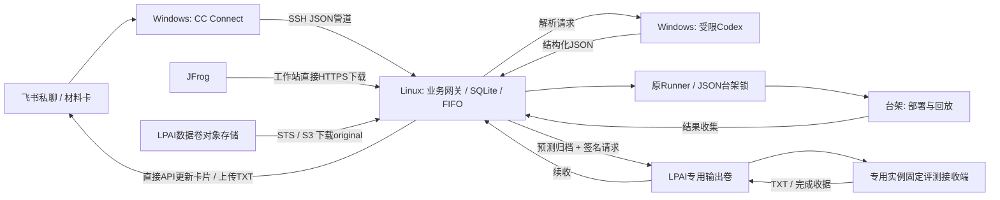

# 当前架构与完整工作流

> 当前流程、现场状态和问题以[2026-11-05文档入口](../../../docs/README.md)为准。本页保留设备配置细节；注明11月3日的观察和ZIP交付范围属于历史快照。

基线日期：2026-11-03。本手册描述源码快照和实际配置，不把历史计划当作部署事实。默认迁移范围是替换 Windows 电脑；Linux 工作站、台架和现有 LPAI 资源继续复用。

当前RoadModel新发布入口存在共享FIFO接入缺口F12，插件隔离存在F13；详见当前问题清单。下图/表中的统一调度是目标和PCM既有路径，不能用于宣称全部RoadModel入口已经接通。

## 四个执行位置

| 位置 | 实际职责 | 不承担的职责 |
|---|---|---|
| Windows 长驻电脑 | 补丁版 CC Connect 持有唯一飞书长连接；连接租约；消息/菜单/回调经 SSH 送入 Linux；另一个后台进程运行受限 Codex 解析 | 不保存 APP、SO、数据集、预测、评测报告或业务 SQLite；不直接刷台架 |
| Linux 工作站 | 唯一业务网关；身份、草稿、确认、素材、全局 FIFO；JFrog 下载；数据卷下载；编译、装配、YAML；Runner 派发；评测上传和 TXT 交付 | 不安装 Codex，不从网络共享挂载读写 SQLite，不运行第二个真实 CC 长连接 |
| 台架 | 软件部署、受控服务切换、预检与真实数据回放 | 不管理飞书会话、用户材料或云端认证 |
| LPAI 专用实例 | 挂载数据/GT及输出卷；固定接收端验签；使用固定原生评测器计算并保存 TXT | 不刷台架，不替代工作站材料与队列，不把预测写回源数据集 |

图中的 SSH 是控制和受限解析通道；APP、回放数据和预测的大字节流不经 Windows。工作站本地执行时，SSH 封装会走本地程序调用，不应误认为同一工作站又绕个人电脑传输。

## 一次任务的阶段

| 阶段 | 执行位置与关键动作 | 持久记录 / 失败边界 |
|---|---|---|
| 收材料 | 飞书文本、转发构建卡、附件；确定性解析优先，必要时请求 Windows Codex | 按真实 open_id 和私聊会话登记；未提交任务合并材料，原卡更新；不执行台架 |
| 确认 | 用户真实点击当前材料卡“确认执行” | 核对原卡、会话、本人、nonce、材料版本；口头执行、保存表单、材料齐全均不能替代 |
| APP/SO准备 | 工作站解析本人确切资产、路径或 HTTPS URL | 版本化 APP 下载复用；跨人资产禁止；新 APP 清除旧 M100/YAML，传感器 SO 保留为候选 |
| 数据规划 | 核对授权工作站源，或列出已授权云端目录的场景 | 场景级检查，不常规逐帧检查；云端先规划，软件与配置通过后再下载 original |
| 静态与装配 | 检查包格式、架构、依赖目标和有限符号；命中受控版本配方才装配副本 | 静态通过不是完整 ABI/运行成功；原 APP 不改；不随机换库 |
| YAML与M100 | 先生成本次 YAML 候选和差异，再尝试本 APP 对应的 M100 编译 | 明确冲突/字段错误先返回；编译失败给出配套材料要求，不无限探索 |
| 绑定 | 冻结输入、生成本任务 Job/Profile、派生受控客户端 | 不修改共享 Recorder；不把绑定 READY_FOR_GATE 当成实机通过 |
| 等待资源 | 工作站唯一硬件 FIFO；其他入口最终由原 Runner JSON 锁兜底 | 排队卡显示前方等待数、当前使用者及异常；正常资源忙等待，损坏/未知执行待核验 |
| 软件部署 | 台架连接正常后才执行传送、解包、依赖替换、服务切换 | 连接正常只证明可达，不证明软件兼容，也不授权越过待核验锁 |
| 启动预检 | 本次范围中的一个完整场景试跑，独立 Run 与收据 | 当前即使只选一场景，也仍保留预检与正式回放策略；失败不全量 |
| 正式回放 | 运行选定场景；上报真实场景计数；恢复正式服务并收集结果 | 100%回放不等于收尾完成，须核对恢复与输出收据；结果未知不重跑 |
| 评测（可选） | 按注册时策略上传预测，在云端与本任务关联GT计算 | 默认回放后评测，明确仅回放跳过；评测失败不重放台架 |
| 交付 | 工作站目录；评测时原始 TXT 经飞书API交付 | 卡片统一更新；可单独交付附件；部分完成必须保留缺项，不改指标冒充成功 |

## 状态与材料记忆

材料任务、Preparation、硬件 Job、预检/正式 Run、云端评测 Job 各有身份，不能用文件夹名互相代替。面向用户的编号是 TJ-YYYYMMDD-NNNN；内部 task-/prep-/gw-/cloud-eval- 用于关联和排障，既有目录不按新显示名改名。

未确认时补 SO/YAML、改链接或路径，只改当前草稿和材料卡。确认后、入队前再补材料会使旧确认失效；提交 Job 后输入冻结，后续文件属于下一份材料。同一文件及无有效变更不重复派发。新 APP 不能沿用上次 M100；相机/雷达可以沿用本人候选，但仍须检查。复用的是输入材料，不是假设台架仍装着这个版本；每次正式执行仍重新部署本次冻结版本。

当前已有“完成后追加评测/到点精度”等历史入口代码；用户已要求后续收敛为两种目标的候选尚未上线。不要因为本手册描述新方案就删除历史任务恢复路径；区别见[现状与限制](09-现状与限制.md)。

## Skill 与程序的边界

- `workstation/gateway/.agents/skills/bench-gateway/SKILL.md` 是生产业务解析指令快照，不是任意命令执行器；源码保留原样供追溯。
- `parser.py` 先走快捷解析；复杂意图/YAML 经 `ai_broker.py`、Windows `ephemeral_ai.py` 返回 JSON，程序再验证。生产解析禁用 shell、浏览器、工具、插件等能力；不能据“桌面 Codex 有浏览器”推断 Bot 能自动网页登录。
- `preparation.py`、`bindings.py`、`candidate_*` 决定装配和派发；`worker.py`、`core.py`、`roadmodel_queue.py` 决定统一调度；`executor.py` 对接受控 Runner。
- 本包另提供 `bench-gateway-operations` 运维 Skill，供接手部署的 Codex 使用；不要用它覆盖生产 JSON 解析 Skill。
